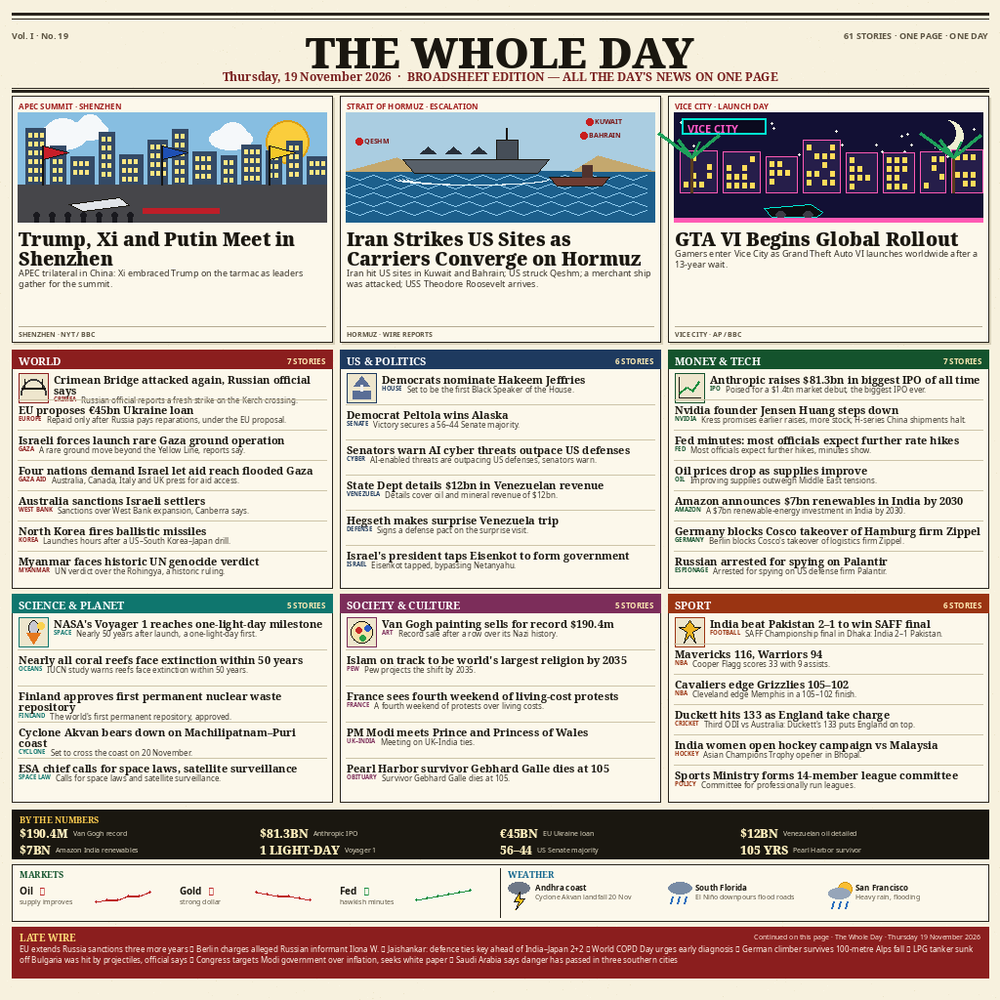

# The Whole Day — Broadsheet Edition (19 November 2026)

[](https://make.fun/c/news-image-20261119)
[](https://make.fun/c/news-image-20261119)
[](https://make.fun/c/news-image-20261119)

One 1024×1024 broadsheet front page summing up Thursday, 19 November 2026 in a single image: 3 illustrated hero stories, 6 colour-coded sections, a By The Numbers band, markets & weather with sparklines and icons, and a Late Wire ticker.

**Story count: 61 stories** — 3 heroes + 30 section cards + 6 sport cards + 8 numbers + 6 markets/weather + 8 ticker items. The renderer counts the items from its own data structures and prints the count.



## Run

```sh
node main.ts          # renders fresh via python3, validates, copies to $MAKEFUN_OUTPUT_DIR (default /output)
python3 broadsheet.py # renders entry.png directly (deterministic, byte-identical across runs)
```

Requires Python 3 with Pillow and Node 22+. If python3/PIL is unavailable, `main.ts` falls back to the committed `entry.png`.
